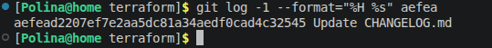
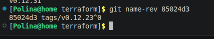
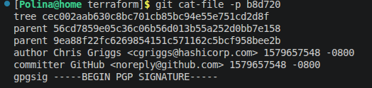
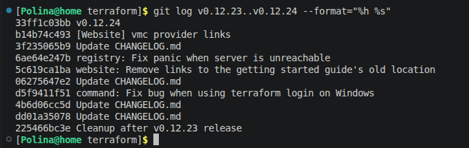
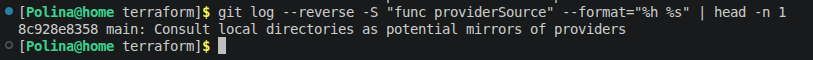
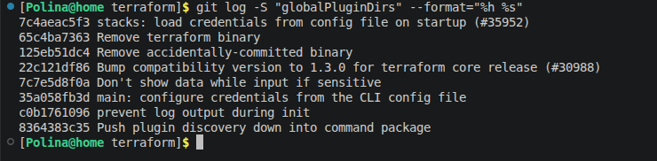
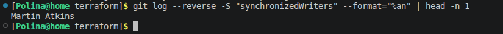

# Домашнее задание к занятию "Инструменты Git" - `Жихарева Полина`

### Цель задания
   
   В результате выполнения задания вы:
   1. научитесь работать с утилитами Git;
   2. потренируетесь решать типовые задачи, возникающие при работе в команде.
   
### Инструкция к заданию

   1. Склонируйте репозиторий с исходным кодом Terraform.
   2. Создайте файл для ответов на задания в своём репозитории, после выполнения прикрепите ссылку на .md-файл с ответами в личном кабинете.
   3. Любые вопросы по решению задач задавайте в разделе "Вопросы по заданию".

---

### Задание 1

git log — стандартная команда для просмотра истории коммитов.
-1 — флаг, который ограничивает вывод только одним коммитом (самым последним, подходящим под условие).
--format="%H %s" — форматирование вывода:
%H — выводит полный 40-символьный хеш коммита (в отличие от %h, который показывает сокращённый 7-символьный хеш).
%s — выводит тему (первую строку) комментария к коммиту.
aefea — это частичный хеш.
Команда git log с флагом --format позволяет получить только то, что необходимо для запроса: полный хеш и комментарий в одну строку.

Полный хеш: aefead2207ef7e2aa5dc81a34aedf0cad4c32545
Комментарий: Update CHANGELOG.md

--- 

Команда git name-rev - Эта команда пытается найти "человеческое имя" (тег или ветку) для указанного хеша. 
Символ ^0 означает, что коммит напрямую соответствует тегу v0.12.23 (а не является его родителем или потомком).

Коммит 85024d3 соответствует тегу v0.12.23

---

Использованная команда: git cat-file -p b8d720.
git cat-file — низкоуровневая команда Git для просмотра содержимого объектов репозитория (коммитов, деревьев, блобов).
-p — флаг "pretty print", который выводит содержимое объекта в читаемом виде.
b8d720 — сокращённый хеш коммита.
Строки, начинающиеся с parent, показывают родителей коммита, в данном случае, присутствуют две такие строки, соответсвенно, у коммита 2 родителя.
Это типичная структура для merge-коммита (коммита слияния), который объединяет две ветки.

Количество родителей: 2
Хеши родителей:
56cd7859e05c36c06b56d013b55a252d0bb7e158
9ea88f22fc6269854151c571162c5bcf958bee2b

--- 

Использованная команда: git log v0.12.23..v0.12.24 --format="%h %s".
git log — просмотр истории коммитов.
v0.12.23..v0.12.24 — диапазон коммитов. Синтаксис A..B означает "показать все коммиты, которые достижимы из B, но не достижимы из A". То есть, это коммиты, которые были добавлены после тега v0.12.23 и до тега v0.12.24 включительно.
--format="%h %s" — форматирование:
%h — сокращённый (7-символьный) хеш коммита.
%s — тема коммита.

---

Использованная команда: git log --reverse -S "func providerSource" --format="%h %s" | head -n 1.
-S "func providerSource" — это флаг Pickaxe. Он ищет коммиты, в которых изменилось количество вхождений указанной строки. То есть, Git показывает коммиты, где эта строка была добавлена или удалена. 
--reverse — меняет порядок вывода: вместо "от нового к старому" (по умолчанию) показывает "от старого к новому". Это необходимо, потому что мы ищем первое появление функции (её создание).
--format="%h %s" — форматирование: сокращённый хеш и тема коммита.
| head -n 1 — оператор конвейера (pipe). Он передаёт вывод команды git log в команду head, которая берёт только первую строку. Поскольку мы использовали --reverse, первая строка - это самый старый коммит, а значит и момент создания функции.
Обычный git log ищет по комментариям к коммитам, а не по содержимому файлов. Флаг -S (Pickaxe) — это специальный инструмент Git для поиска изменений в коде. Комбинация --reverse и head -n 1 позволяет найти именно первое появление строки.

--- 

Использованная команда: git log -S "globalPluginDirs" --format="%h %s".
-S "globalPluginDirs" — снова флаг Pickaxe, который ищет все коммиты, где изменилось количество вхождений строки globalPluginDirs. Это покажет все моменты, когда функция создавалась, изменялась или удалялась.
--format="%h %s" — форматирование: сокращённый хеш и тема коммита.
Без флага --reverse — вывод идёт в стандартном порядке: от новых коммитов к старым.
Без head -n 1 — мы показываем все найденные коммиты, а не только первый.

---

Использованная команда: git log --reverse -S "synchronizedWriters" --format="%an" | head -n 1.
-S "synchronizedWriters" — флаг Pickaxe ищет коммиты, где изменилось количество вхождений строки.
--reverse — сортирует от старого к новому, чтобы первым шёл коммит создания функции.
--format="%an" — форматирование:
%an — выводит только имя автора (Author Name) коммита.
| head -n 1 — берёт только первую строку (самого первого автора).

---